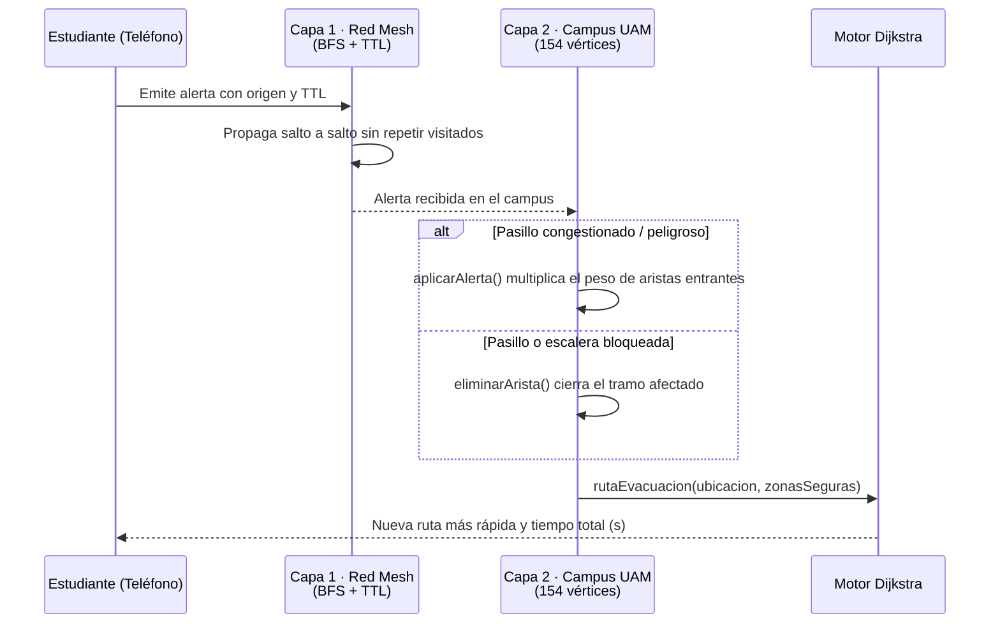

<div align="center">
  

  <h1>Unexuam</h1>

  <em>Evacuación Off-Grid para el campus UAM con grafos dirigidos y ponderados</em>

  <br /><br />

  [](https://www.python.org)
  [](https://flask.palletsprojects.com)
  [](mobile/)
  
  
  
  
</div>

<br />

<div align="center">
  <sub>Guiando a la comunidad universitaria hacia zonas seguras cuando colapsan internet y la red celular — sin librerías externas de grafos.</sub>
</div>

<br />

<div align="center">


**[Descripción general](#descripción-general)** · **[Las dos capas](#las-dos-capas-de-grafos)** · **[Funcionalidades](#funcionalidades-y-pantallas)** · **[Tecnologías y diseño](#tecnologías-y-diseño)** · **[Arquitectura](#arquitectura-y-estructura)** · **[Base de datos](#base-de-datos-basedatospy)** · **[Instalación](#instalación-y-ejecución)** · **[Comandos](#comandos-útiles)** · **[Pruebas](#pruebas-y-validación)**

</div>

<br />


## Descripción general

**Unexuam** es un prototipo de sistema de emergencia y evacuación **Off-Grid** para el campus real de la **Universidad Americana (UAM)**, desarrollado como proyecto final de **Programación Estructurada** (noviembre 2026) por **Br. James Santiago Fernandez Obregon**.

Está diseñado para operar cuando se caen internet y la red celular. Funciona de dos formas: como **web móvil** servida por una PC en la red Wi-Fi local (sin internet) y como **app Android** que no necesita la PC.

- **Grafos hechos a mano** — implementación pura en Python con las clases `Vertex` (`nombre`, `neig`) y `Graph` (`vertexs`), sin NetworkX ni `heapq`.
- **Alertas por la red Mesh** — una alerta sale desde tu teléfono y salta de teléfono en teléfono mediante **BFS limitado por TTL** (alcance de 1 a 5 saltos).
- **Mensajes sin internet** — cada persona entra con su **CIF y contraseña**; su teléfono se vuelve un vértice de la red Mesh y los mensajes viajan por la ruta de menor retardo (**Dijkstra**). Si no hay camino, esperan en una **cola DTN** y salen solos cuando aparece uno.
- **Evacuación dinámica sobre el campus real** — 154 vértices y 442 aristas dirigidas construidas a partir del plano real de OpenStreetMap de la UAM; el **GPS** detecta en qué edificio o zona segura estás y **Dijkstra** recalcula la ruta al moverte o ante bloqueos y congestión.

> [!NOTE]
> En la **web**, los teléfonos se comunican a través del servidor Unexuam en la red Wi-Fi local y la red Mesh entre ellos se modela como un grafo. En la **app Android** el enlace es real: con **Google Nearby Connections** (Bluetooth / Wi-Fi) los teléfonos cercanos se envían los mensajes directamente, sin PC ni internet. Sin internet o en modo avión la app pide activar el Bluetooth, y cada mensaje salta de teléfono en teléfono con TTL, lista de identificadores ya vistos y guardar-y-reenviar. Requiere Google Play Services.

<br />


## Las dos capas de grafos

Unexuam acopla dos grafos dirigidos y ponderados que reaccionan en cadena durante una emergencia:

| Capa | Vértices | Aristas (peso) | Algoritmo | Módulo |
|---|---|---|---|---|
| -CC0000?style=flat-square) | Teléfonos de los estudiantes | Enlace entre dispositivos (retardo en s) | **BFS limitado por TTL** (`propagarAlerta`) | `backend/mesh.py` |
| -0080FF?style=flat-square) | **154 vértices**: aulas por piso de edificios B, C y P, pabellones este/oeste, escaleras (incluyendo unión central B–C), pasarela del B, salidas, edificios y **12 zonas/puntos seguros** | Paso a pie entre lugares (tiempo en s; **442 aristas**) | **Dijkstra** (`dijkstra`, `rutaMasCorta`, `rutaEvacuacion`) | `backend/evacuacion.py` |

### Flujo ante una emergencia



<br />


## Funcionalidades y pantallas

Se entra con **CIF y la contraseña** elegida al crear la cuenta (se guarda con hash). El botón **Demo rápida · Admin** entra como administrador sin contraseña (solo para la demostración). La navegación inferior es una barra de vidrio con las pestañas **Inicio**, **Evacuar**, **Mensajes** y **Admin** (esta última solo para el administrador).

| Pestaña | Qué hace |
|---|---|
|  | Estado de las dos redes y actividad en vivo. |
|  | **GPS** («Activar»): detecta en qué edificio o zona segura estás (polígonos de OpenStreetMap en `ubicacion-campus.json`) y te guía; la ruta se recalcula al moverte. Buscador de aulas, guía paso a paso con voz, selector de piso para los edificios B, C y P y mapa 3D con la ruta dibujada como grafo. |
|  | Chats tipo WhatsApp. Los contactos se agregan buscando su **CIF**. Cada mensaje muestra sus saltos y su retardo por la red Mesh (Dijkstra por retardo); sin camino espera en la **cola DTN** y se entrega cuando aparece uno. El botón rojo **Alerta** envía una alerta desde tu teléfono propagada con **BFS + TTL** (alcance 1–5). |
|  | Solo administrador. Paneles **Grafos** (editar vértices y aristas), **Dijkstra 2D** (paso a paso, por ejemplo desde `C-101` hasta el punto seguro más cercano) y **Simulacros**. Desde aquí se bloquean o congestionan pasillos y se abre **«Ver la red Mesh (BFS con TTL)»**, con los teléfonos, sus enlaces dirigidos y la alerta animada salto a salto. |
|  | Interfaz de consola clásica del curso (`python -m backend.menu`) para probar operaciones de grafos sin levantar el servidor web. |

<br />


## Tecnologías y diseño

| Categoría | Tecnología | Detalle |
|---|---|---|
|  | **Python 3.10+** | Lógica completa de grafos, BFS y Dijkstra implementada desde cero sin librerías externas. |
|  | **Flask** | Grafos en memoria protegidos con `threading.Lock`, API REST JSON y servicio por http (5000) y https (5443, certificado autofirmado con `cryptography`). |
|  | **SQLite** | Cuentas, contactos y mensajes en `datos/unexuam.db` mediante `basedatos.py` (incluido en Python, sin internet). |
|  | **HTML5 · CSS3 · JS vanilla** | Interfaz móvil sin frameworks ni CDNs: funciona completamente sin internet. |
|  | **Capacitor + Nearby Connections** | APK autónomo (`ni.edu.uam.unexuam`) con el grafo exportado desde `backend/datos.py`, motor offline y enlace directo entre teléfonos por Bluetooth / Wi-Fi. |
|  | **OpenStreetMap + SVG 3D** | Geometría real del campus (`campus-plano.json`, `ubicacion-campus.json` y `img/mapa-campus-3d.svg`). |
|  | **unittest** | Suite de 55 pruebas de backend, API, sesión, mensajería y paridad del mapa. |

### Sistema de diseño

La interfaz sigue una estética móvil de alta legibilidad para situaciones de emergencia, con píldoras de `30 px`, tipografía **Montserrat** (servida desde `frontend/static/fonts/`; el manual de marca indica Nexa y Montserrat es su sustituta para funcionar sin internet) y cuatro colores de alto contraste:


 `azul #0080FF` &nbsp;&nbsp;  `rojo #E23000` &nbsp;&nbsp;  `amarillo #FCD222` &nbsp;&nbsp;  `verde #00D656`

<br />


## Arquitectura y estructura

### Estructura del repositorio

```text
unexuam/
├── app.py                     # Servidor Flask: grafos en memoria, sesión y API JSON (http 5000 / https 5443)
├── basedatos.py               # SQLite: tablas usuarios, contactos y mensajes
├── backend/                   # Lógica pura de grafos (sin dependencias externas)
│   ├── grafo.py               # Clases Vertex (nombre, neig) y Graph (vertexs)
│   ├── datos.py               # Campus real UAM (154 vértices, 442 aristas) y red Mesh (8 teléfonos)
│   ├── evacuacion.py          # dijkstra, rutaMasCorta, rutaEvacuacion, aplicarAlerta
│   ├── mesh.py                # propagarAlerta (BFS limitado por TTL)
│   ├── mensajeria.py          # Teléfonos en la red, rutas de mensajes y cola DTN
│   └── menu.py                # Menú interactivo de consola
├── frontend/                  # Interfaz web móvil 100% offline
│   ├── templates/index.html   # Estructura de la aplicación
│   └── static/
│       ├── app.js             # Inicio, Evacuar, mapa 3D y Admin (grafos, simulacros, red Mesh)
│       ├── cuenta.js          # Sesión con CIF, contactos, mensajes, Alerta y Dijkstra 2D
│       ├── ubicacion.js       # GPS: punto dentro de polígono sobre ubicacion-campus.json
│       ├── nearby.js          # Puente con el plugin Nearby de Android (mensajes entre teléfonos)
│       ├── ubicacion-campus.json · campus-plano.json
│       └── fonts/ · img/ · sw.js · manifest.json
├── tests/
│   ├── test_backend.py        # Grafos, BFS, Dijkstra, Dijkstra paso a paso y mensajería
│   └── test_api.py            # API, sesión, permisos de administrador, mensajes y paridad
├── mobile/                    # App Android autónoma (Capacitor)
│   ├── motor-offline.js       # Motor de grafos, cuentas y mensajes en el teléfono
│   └── android/.../unexuam/UnexuamNearbyPlugin.java   # Nearby Connections (Bluetooth / Wi-Fi)
└── docs/
    ├── propuesta/             # Propuesta formal del proyecto (.docx y .md)
    ├── pitch/                 # Diapositivas (deck.html) y capturas
    └── mapa-campus/           # Scripts de extracción OSM y generación del mapa 3D/grafo
```

La carpeta `datos/` (base de datos, clave de sesión y certificado HTTPS) se crea al arrancar y no está en el repositorio.

### Base de datos (`basedatos.py`)

SQLite en `datos/unexuam.db`. Las contraseñas se guardan con hash (werkzeug), nunca en texto plano.

| Tabla | Columnas | Relación |
|---|---|---|
| `usuarios` | `cif` (PK), `nombre`, `hash`, `telefono` (único, vértice de la red Mesh), `lugar` (vértice del campus), `admin`, `creado` | — |
| `contactos` | `dueno_cif`, `contacto_cif` (PK compuesta), `agregado` | ambos → `usuarios.cif` |
| `mensajes` | `id` (PK), `de_cif`, `para_cif`, `tipo` (`texto` / `alerta`), `texto`, `enviado`, `estado` (`entregado` / `en cola`), `ruta` (JSON de teléfonos recorridos), `retardo`, `entregado`, `via_cola` | `de_cif`, `para_cif` → `usuarios.cif` |

### API JSON (`app.py`)

Todas las rutas requieren sesión salvo `lugares`, `yo`, `registro`, `login` y `login/demo`. Las marcadas con **Admin** responden `403` a quien no es administrador.

| Método y ruta | Acceso | Acción |
|---|---|---|
| `GET /api/lugares` | Libre | Lugares del campus para elegir dónde estás. |
| `GET /api/yo` | Libre | Usuario de la sesión actual (o ninguno). |
| `POST /api/registro` · `login` · `login/demo` · `logout` | Libre / sesión | Cuenta con CIF y contraseña (hash), acceso demo de administrador y cierre de sesión. |
| `POST /api/yo/lugar` | Sesión | Mueve tu teléfono a un lugar del campus y lo enlaza con los que están a su alcance. |
| `POST /api/contactos/buscar` · `agregar` | Sesión | Busca a una persona por su CIF y la agrega a tus contactos. |
| `GET /api/mensajes` | Sesión | Tus contactos y conversaciones, con el estado de cada mensaje (entregado o en cola). |
| `POST /api/mensajes/enviar` | Sesión | Envía por la ruta de menor retardo (Dijkstra) o deja el mensaje en la cola DTN. |
| `POST /api/mensajes/alerta` | Sesión | Alerta desde tu teléfono con `propagarAlerta` (BFS + TTL). |
| `GET /api/estado` | Sesión | Ambos grafos serializados, zonas seguras, ruta, bloqueos, congestión e historial. |
| `POST /api/campus/ruta` | Sesión | `rutaEvacuacion` desde un lugar sin alterar el estado compartido. |
| `POST /api/reiniciar` | **Admin** | Restaura la red Mesh, el campus o ambos. |
| `POST /api/mesh/alerta` | **Admin** | `propagarAlerta(red, origen, ttl)` desde cualquier teléfono de la red Mesh. |
| `POST /api/campus/ubicacion` | **Admin** | Fija la ubicación del simulacro y calcula la ruta más rápida. |
| `POST /api/campus/bloquear` · `desbloquear` | **Admin** | Cierra (`eliminarArista`) o reabre (`insertarArista`) pasillos o escaleras. |
| `POST /api/campus/congestionar` | **Admin** | `aplicarAlerta(campus, lugar, factor)`: multiplica el peso de las aristas entrantes. |
| `POST /api/<grafo>/vertice` · `arista` | **Admin** | Alta, baja y actualización de vértices y aristas en `mesh` o `campus`. |
| `GET/POST /api/algoritmo` | **Admin** | Dijkstra paso a paso desde un lugar hasta la zona segura más cercana. |

<br />


## Instalación y ejecución

### Requisitos previos

- **Python 3.10** o superior
- **Flask** y **cryptography** (`pip install flask cryptography`)
- Para la app Android: Node.js 18+, JDK 17+ y Android SDK (ver paso 5)

### 1. Clonar e instalar

```powershell
git clone https://github.com/jamesjsfouam/unexuam.git
cd unexuam
pip install flask cryptography
```

`cryptography` genera el certificado autofirmado que activa **https**; sin él el servidor arranca solo por http y el GPS del navegador no funciona.

### 2. Ejecutar el servidor

```powershell
python app.py
```

La consola imprimirá las direcciones de acceso:

```text
 En este PC:        http://127.0.0.1:5000
 Desde el teléfono: http://192.168.x.x:5000  (misma Wi-Fi)
 Con GPS (https):   https://192.168.x.x:5443  (acepta el aviso del certificado)
```

> [!IMPORTANT]
> El navegador solo permite el **GPS** en páginas **https**. Usa la dirección `https://IP-del-PC:5443` y acepta el aviso del certificado autofirmado («Configuración avanzada» → «Continuar»).

### 3. Conectar teléfonos en la misma red

1. Conecta los teléfonos a la **misma Wi-Fi** que el PC (o crea un punto de acceso desde el teléfono y conecta el PC a él).
2. Abre en el navegador del teléfono la dirección **«Con GPS (https)»** (o la de http si no usarás el GPS).
3. Si no carga, en el **Firewall de Windows** permite Python en **redes privadas** o abre los puertos TCP `5000` y `5443`:

   ```powershell
   # PowerShell como administrador
   New-NetFirewallRule -DisplayName "Unexuam" -Direction Inbound -Protocol TCP -LocalPort 5000,5443 -Action Allow -Profile Private
   ```

4. Opcional: usa **«Agregar a la pantalla de inicio»** para abrirla como aplicación móvil (`manifest.json`).

### 4. Prueba con dos teléfonos

**A. Web, a través del servidor**

1. Con `python app.py` encendido, abre `https://IP-del-PC:5443` en **los dos teléfonos**.
2. En cada uno toca **Crear cuenta** con un CIF distinto y una contraseña.
3. En **Mensajes**, busca el CIF de la otra persona y agrégala. Abre el chat y escribe.
4. Cada mensaje indica cuántos saltos dio y su retardo. Si un teléfono queda lejos de todos (en **Evacuar** con el GPS o cambiando su lugar), el mensaje espera en la cola DTN y se entrega solo cuando vuelve a haber camino.
5. Toca **Alerta**, elige el alcance (1–5) y envíala: llega a quienes estén dentro de ese número de saltos.

**B. App Android, por Nearby y sin servidor**

1. Instala el APK (paso 5) en **dos teléfonos Android** con Google Play Services. No hace falta la PC ni internet.
2. Pon ambos en **modo avión** (o sin datos ni Wi-Fi). Al abrir la app pide **activar el Bluetooth**: acepta, y concede el permiso de **dispositivos cercanos** (y de ubicación en Android 12 o anterior).
3. En cada teléfono, **Crear cuenta** con un CIF distinto. Las cuentas quedan en el propio teléfono.
4. Mantén los teléfonos cerca (unos metros). En **Mensajes**, busca el CIF del otro: aparece porque está cerca por Nearby. Agrégalo y escribe.
5. El mensaje viaja directo por Bluetooth / Wi-Fi. Si el otro teléfono se aleja, el mensaje queda en cola y sale solo cuando se vuelven a conectar. Con tres o más teléfonos, los intermedios reenvían el mensaje (TTL, identificadores ya vistos y guardar-y-reenviar).

### 5. Compilar la app Android (APK autónomo)

Requisitos: **Node.js 18+**, **JDK 17+** y **Android SDK**. La carpeta [`mobile/`](mobile/) empaqueta la aplicación para que funcione en Android **sin la PC encendida**:

```powershell
cd mobile
npm install            # solo la primera vez
npm run sync           # exporta backend/datos.py + frontend/ al proyecto Android
cd android
.\gradlew.bat assembleDebug
```

El APK queda en `mobile/android/app/build/outputs/apk/debug/app-debug.apk`.

<br />


## Comandos útiles

| Comando | Descripción |
|---|---|
| `python app.py` | Levanta el servidor en `http://0.0.0.0:5000` y `https://0.0.0.0:5443` |
| `python -m backend.menu` | Abre el menú interactivo de consola para operar los grafos |
| `python -m unittest discover -s tests -v` | Ejecuta las 55 pruebas |
| `cd mobile && npm run sync` | Sincroniza el grafo de `backend/datos.py` y el frontend con Android |

<br />


## Pruebas y validación

La suite en [`tests/`](tests/) incluye **55 pruebas automatizadas** (`test_backend.py` + `test_api.py`):

```powershell
python -m unittest discover -s tests -v
```

Cubren las operaciones fundamentales de `Graph` (inserción, búsqueda, eliminación de vértices/aristas y actualización de pesos), la propagación BFS con límite de `TTL` y prevención de ciclos en `propagarAlerta`, el cálculo de rutas mínimas con `dijkstra` / `rutaEvacuacion`, la reevaluación de rutas tras `aplicarAlerta` y bloqueos, el registro e inicio de sesión, los permisos de administrador y la entrega de mensajes directa o desde la cola DTN.

<br />

---

<div align="center">
  

  <br />

  <sub><strong>Unexuam · Evacuación Off-Grid · Campus UAM</strong></sub>
  <br />
  <sub>Plano del campus basado en datos de © colaboradores de <a href="https://www.openstreetmap.org/copyright">OpenStreetMap</a> (licencia ODbL).</sub>
</div>
