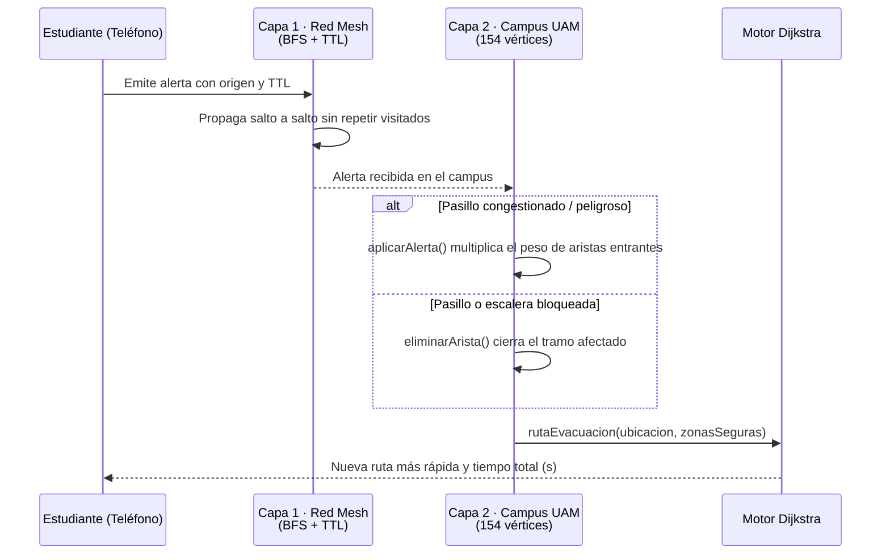

<div align="center">
  

  <h1>Unexuam</h1>

  <em>Evacuación Off-Grid para el campus UAM con grafos dirigidos y ponderados</em>

  <br /><br />

  [](https://www.python.org)
  [](https://flask.palletsprojects.com)
  [](mobile/)
  [](firestore.rules)
  
  
  
  
</div>

<br />

<div align="center">
  <sub>Guiando a la comunidad universitaria hacia zonas seguras cuando colapsan internet y la red celular — sin librerías externas de grafos.</sub>
</div>

<br />

<div align="center">


**[Descripción general](#descripción-general)** · **[Las dos capas](#las-dos-capas-de-grafos)** · **[Funcionalidades](#funcionalidades-y-pantallas)** · **[Tecnologías y diseño](#tecnologías-y-diseño)** · **[Arquitectura](#arquitectura-y-estructura)** · **[Base de datos](#base-de-datos-basedatospy)** · **[Instalación](#instalación-y-ejecución)** · **[Comandos](#comandos-útiles)** · **[Pruebas](#pruebas-y-validación)**

</div>

<br />


## Descripción general

**Unexuam** es un prototipo de sistema de emergencia y evacuación **Off-Grid** para el campus real de la **Universidad Americana (UAM)**, desarrollado como proyecto final de **Programación Estructurada** (noviembre 2026) por **Br. James Santiago Fernandez Obregon**.

Está diseñado bajo una arquitectura híbrida **Nube + Off-Grid**: cuando hay conectividad sincroniza cuentas, mensajes, contactos y alertas oficiales mediante **Firebase (Cloud Firestore `unexuam-campus-ni` + FCM Push)**, y cuando se caen internet y la red celular continúa operando como **web móvil LAN** servida por Flask o como **app Android autónoma** sin PC mediante **Nearby Connections** y **cola DTN**.

- **Grafos hechos a mano** — implementación pura en Python con las clases `Vertex` (`nombre`, `neig`) y `Graph` (`vertexs`), sin NetworkX ni `heapq`.
- **Arquitectura híbrida Nube + Mesh Off-Grid** — sincronización en tiempo real con **Cloud Firestore (`unexuam-campus-ni`)** y notificaciones push **FCM** (`campus_emergencias`), con respaldo directo entre teléfonos vía **BFS limitado por TTL** (1 a 5 saltos) cuando no hay señal.
- **Mensajes y seguridad por CIF** — validación de **CIF único desde el paso 1** (`/api/registro/disponible`), detección de colisiones en la red Mesh y envío por menor retardo (**Dijkstra**); si no hay camino, esperan en una **cola DTN** y salen solos al reconectarse.
- **Evacuación dinámica y accesibilidad** — **154 vértices** y **442 aristas dirigidas** sobre OpenStreetMap de la UAM (`Kioskos del Chilamate`, `El Ranchito`, aulas B/C/P y 12 zonas/puntos seguros); **GPS** + mapa 3D GPU + guía por voz y soporte 100 % offline en **3 idiomas** (**Español**, **English**, **Mískitu**).
- **Emergencias Nicaragua y alarma Admin** — acceso directo a líneas nacionales (**115 Bomberos**, **128 Cruz Blanca**, **100 SINAPRED**) y sirena/pantalla de emergencia global exclusiva del rol **Admin**, con pantalla de carga nativa Android a **120 FPS**.

> [!NOTE]
> En la **web**, los teléfonos se comunican a través del servidor Unexuam en la red Wi-Fi local y la red Mesh entre ellos se modela como un grafo. En la **app Android** el enlace es real: con **Google Nearby Connections** (Bluetooth / Wi-Fi) los teléfonos cercanos se envían los mensajes directamente, sin PC ni internet. Sin internet o en modo avión la app pide activar el Bluetooth, y cada mensaje salta de teléfono en teléfono con TTL, lista de identificadores ya vistos y guardar-y-reenviar. Requiere Google Play Services.

<br />


## Las dos capas de grafos

Unexuam acopla dos grafos dirigidos y ponderados que reaccionan en cadena durante una emergencia:

| Capa | Vértices | Aristas (peso) | Algoritmo | Módulo |
|---|---|---|---|---|
| -CC0000?style=flat-square) | Teléfonos de los estudiantes | Enlace entre dispositivos (retardo en s) | **BFS limitado por TTL** (`propagarAlerta`) | `backend/mesh.py` |
| -0080FF?style=flat-square) | **154 vértices**: aulas por piso de edificios B, C y P, pabellones este/oeste, escaleras (incluyendo unión central B–C), pasarela del B, salidas, edificios y **12 zonas/puntos seguros** | Paso a pie entre lugares (tiempo en s; **442 aristas**) | **Dijkstra** (`dijkstra`, `rutaMasCorta`, `rutaEvacuacion`) | `backend/evacuacion.py` |

### Flujo ante una emergencia



<br />


## Funcionalidades y pantallas

Se entra con **CIF único y la contraseña** elegida al crear la cuenta (validación desde el paso 1 vía `/api/registro/disponible`, guardada con hash PBKDF2-SHA256 / scrypt), con botón integrado para mostrar u ocultar la contraseña. Las cuentas de **Admin** se autentican con credenciales reales para habilitar la gestión de grafos y emergencias globales. La navegación inferior es una barra de vidrio con las pestañas **Inicio**, **Evacuar**, **Mensajes**, **Ajustes** y **Admin** (esta última solo para el administrador).

| Pestaña | Qué hace |
|---|---|
|  | Estado híbrido (**Nube Firebase + Mesh Off-Grid**), actividad en vivo, deslizador **🆘 SOS** con vibración háptica y bloqueo anti-spam de 2 s, píldoras rápidas de emergencia nacional (**115 Bomberos**, **128 Cruz Blanca**, **100 SINAPRED**) y banner/sirena de emergencia global activada únicamente por **Admin** (`campus/estado` + FCM). |
|  | **GPS** («Activar»): detecta tu ubicación (polígonos OSM en `ubicacion-campus.json`, incluyendo `Kioskos del Chilamate` y `El Ranchito`) y recalcula al moverte. Buscador de aulas, guía paso a paso con voz, selector de piso para edificios B, C y P y **mapa 3D acelerado por GPU** con la ruta dibujada como grafo. |
|  | Chats tipo WhatsApp con sincronización híbrida (**Cloud Firestore + Nearby Connections + cola DTN**). Los contactos se agregan verificando su **CIF** (con alerta de colisiones en la red Mesh). Cada mensaje muestra sus saltos y retardo (Dijkstra por retardo), más el **Canal General · Campus** para notificaciones SOS. |
|  | Selector de idioma 100 % offline (**Español**, **English**, **Mískitu** vía `i18n.js`), modo de texto grande, alto contraste, guía por voz y diagnóstico de conexión Nube/Mesh. |
|  | Solo administrador. Paneles **Grafos** (editar vértices y aristas), **Dijkstra 2D** (paso a paso desde `C-101` hasta el punto seguro más cercano) y **Simulacros / Emergencia global** (`campus/estado` + alerta FCM a toda la app). Desde aquí se bloquean o congestionan pasillos y se abre **«Ver la red Mesh (BFS con TTL)»**. |
|  | Interfaz de consola clásica del curso (`python -m backend.menu`) para operar los grafos sin levantar el servidor web. |

<br />


## Tecnologías y diseño

| Categoría | Tecnología | Detalle |
|---|---|---|
|  | **Python 3.10+** | Lógica completa de grafos, BFS y Dijkstra implementada desde cero sin librerías externas. |
|  | **Flask** | Grafo del campus y emergencia activa persistidos en SQLite, API REST JSON y TLS configurable. |
|  | **SQLite** | Cuentas, contactos y mensajes en `datos/unexuam.db` mediante `basedatos.py` (incluido en Python, sin internet). |
|  | **HTML5 · CSS3 · JS vanilla** | Interfaz móvil Liquid Glass 60 FPS sin frameworks ni CDNs: funciona completamente sin internet. |
|  | **Cloud Firestore + FCM** | Proyecto `unexuam-campus-ni` (`nube-firebase.js`, `firestore.rules`, `UnexuamMessagingService.java`, tema `campus_emergencias`) para cuentas, mensajes y estado oficial del campus en tiempo real. |
|  | **Capacitor + Nearby + FCM** | APK autónomo (`ni.edu.uam.unexuam`) con splash nativo a 120 FPS (`SplashNativoView.java`), `MeshForegroundService`, `EmergencyAlertActivity` y enlace directo por Bluetooth / Wi-Fi. |
|  | **i18n.js (ES · EN · MIQ)** | Traducción 100 % offline en **Español**, **English** y **Mískitu** para Login, Inicio y Ajustes. |
|  | **OpenStreetMap + SVG 3D** | Geometría real del campus (`campus-plano.json`, `ubicacion-campus.json` y `img/mapa-campus-3d.svg`) con zoom/pan por GPU. |
|  | **unittest + Offline + Estrés** | Suite de **69 pruebas Python** + **6 escenarios JS offline** (`0 ResourceWarning`), auditoría post-remediación **33/33 PASS** (`VERIFICACION_POST_REMEDIACION_UNEXUAM.md`) y estrés de **40 dispositivos concurrentes** (`40/40 OK` en `3.12 s`). |

### Sistema de diseño

La interfaz sigue una estética móvil de alta legibilidad para situaciones de emergencia, con píldoras de `30 px`, tipografía **Montserrat** (servida desde `frontend/static/fonts/`; el manual de marca indica Nexa y Montserrat es su sustituta para funcionar sin internet) y cuatro colores de alto contraste:


 `azul #0080FF` &nbsp;&nbsp;  `rojo #E23000` &nbsp;&nbsp;  `amarillo #FCD222` &nbsp;&nbsp;  `verde #00D656`

<br />


## Arquitectura y estructura

### Estructura del repositorio

```text
unexuam/
├── app.py                     # Servidor Flask: grafos en memoria, sesión y API JSON (http 5000 / https 5443)
├── basedatos.py               # SQLite: tablas usuarios, contactos y mensajes
├── firebase.json · .firebaserc · firestore.rules   # Configuración y reglas del proyecto Firebase unexuam-campus-ni
├── backend/                   # Lógica pura de grafos (sin dependencias externas)
│   ├── grafo.py               # Clases Vertex (nombre, neig) y Graph (vertexs)
│   ├── datos.py               # Campus real UAM (154 vértices, 442 aristas) y red Mesh (8 teléfonos)
│   ├── evacuacion.py          # dijkstra, rutaMasCorta, rutaEvacuacion, aplicarAlerta
│   ├── mesh.py                # propagarAlerta (BFS limitado por TTL)
│   ├── mensajeria.py          # Teléfonos en la red, rutas de mensajes y cola DTN
│   └── menu.py                # Menú interactivo de consola
├── frontend/                  # Interfaz web móvil 100% offline + sincronización Firebase
│   ├── templates/index.html   # Estructura de la aplicación
│   └── static/
│       ├── app.js             # Inicio, píldoras 115/128/100, Evacuar, mapa 3D y Admin
│       ├── cuenta.js          # Sesión con CIF único, contactos, mensajes DTN, SOS, GPS y Dijkstra 2D
│       ├── nube-firebase.js   # Cliente REST Cloud Firestore (cuentas, mensajes, campus/estado)
│       ├── i18n.js            # Traducción 100 % offline (Español, English, Mískitu)
│       ├── ajustes.js         # Preferencias de accesibilidad, idioma y estado de red
│       ├── ubicacion.js       # GPS: punto dentro de polígono sobre ubicacion-campus.json
│       ├── ubicacion-campus.json · campus-plano.json
│       └── fonts/ · img/ · sw.js · manifest.json
├── tests/
│   ├── test_backend.py        # Grafos, BFS, Dijkstra, Dijkstra paso a paso y mensajería
│   └── test_api.py            # API, sesión, validación de CIF, permisos de Admin y paridad
├── mobile/                    # App Android autónoma (Capacitor)
│   ├── motor-offline.js       # Motor de grafos, cuentas y mensajes en el teléfono
│   └── android/.../unexuam/   # Puente y servicios nativos Android
│       ├── MainActivity.java              # Contenedor Capacitor + splash overlay nativo
│       ├── SplashNativoView.java          # Animación nativa a 120 FPS (RenderThread)
│       ├── MeshNativa.java                # Nearby Connections (Bluetooth / Wi-Fi Direct)
│       ├── MeshForegroundService.java     # Servicio Mesh en segundo plano
│       ├── UnexuamMessagingService.java   # Receptor FCM (tema campus_emergencias)
│       └── EmergencyAlertActivity.java    # Pantalla completa de alerta y sirena Admin
└── docs/
    ├── propuesta/             # Propuesta formal del proyecto (.docx y .md)
    ├── pitch/                 # Diapositivas (deck.html) y capturas
    └── mapa-campus/           # Scripts de extracción OSM y generación del mapa 3D/grafo
```

La carpeta `datos/` (base de datos, clave de sesión y certificado HTTPS) se crea al arrancar y no está en el repositorio.

### Base de datos (`basedatos.py`)

SQLite en `datos/unexuam.db`. Las contraseñas se guardan con hash (werkzeug), nunca en texto plano.

| Tabla | Columnas | Relación |
|---|---|---|
| `usuarios` | `cif` (PK), `nombre`, `hash`, `telefono` (único, vértice de la red Mesh), `lugar` (vértice del campus), `admin`, `creado` | — |
| `contactos` | `dueno_cif`, `contacto_cif` (PK compuesta), `agregado` | ambos → `usuarios.cif` |
| `mensajes` | `id` (PK), `de_cif`, `para_cif`, `tipo` (`texto` / `alerta`), `texto`, `enviado`, `estado` (`entregado` / `en cola`), `ruta` (JSON de teléfonos recorridos), `retardo`, `entregado`, `via_cola` | `de_cif`, `para_cif` → `usuarios.cif` |

### API JSON (`app.py`)

Todas las rutas requieren sesión salvo `lugares`, `yo`, `campus/publico`, `mensajes/general`, `registro`, `registro/disponible`, `login` y `logout`. Las marcadas con **Admin** responden `403` a quien no es administrador.

| Método y ruta | Acceso | Acción |
|---|---|---|
| `GET /api/lugares` | Libre | Lugares del campus para elegir dónde estás. |
| `GET /api/yo` | Libre | Usuario de la sesión actual (o ninguno). |
| `GET/POST /api/registro/disponible` | Libre | Verifica en vivo si un CIF ya está registrado desde el paso 1. |
| `POST /api/registro` · `login` · `logout` | Libre / sesión | Cuenta con CIF único y contraseña (hash), acceso de estudiante/admin y cierre de sesión. |
| `POST /api/yo/lugar` | Sesión | Mueve tu teléfono a un lugar del campus y lo enlaza con los que están a su alcance. |
| `POST /api/contactos/buscar` · `agregar` | Sesión | Busca a una persona por su CIF y la agrega a tus contactos. |
| `GET /api/mensajes` | Sesión | Tus contactos y conversaciones, con el estado de cada mensaje (entregado o en cola). |
| `POST /api/mensajes/enviar` | Sesión | Envía por la ruta de menor retardo (Dijkstra) o deja el mensaje en la cola DTN. |
| `POST /api/mensajes/alerta` | Sesión | Alerta desde tu teléfono con `propagarAlerta` (BFS + TTL). |
| `GET /api/estado` | Sesión | Ambos grafos serializados, zonas seguras, ruta, bloqueos, congestión e historial. |
| `POST /api/campus/ruta` | Sesión | `rutaEvacuacion` desde un lugar sin alterar el estado compartido. |
| `POST /api/reiniciar` | **Admin** | Restaura la red Mesh, el campus o ambos. |
| `POST /api/emergencia/declarar` · `finalizar` | **Admin** | Declara o finaliza la emergencia oficial del campus (`campus/estado` + alerta global). |
| `POST /api/mesh/alerta` | **Admin** | `propagarAlerta(red, origen, ttl)` desde cualquier teléfono de la red Mesh. |
| `POST /api/campus/ubicacion` | **Admin** | Fija la ubicación del simulacro y calcula la ruta más rápida. |
| `POST /api/campus/bloquear` · `desbloquear` | **Admin** | Cierra (`eliminarArista`) o reabre (`insertarArista`) pasillos o escaleras. |
| `POST /api/campus/congestionar` | **Admin** | `aplicarAlerta(campus, lugar, factor)`: multiplica el peso de las aristas entrantes. |
| `POST /api/<grafo>/vertice` · `arista` | **Admin** | Alta, baja y actualización de vértices y aristas en `mesh` o `campus`. |
| `GET/POST /api/algoritmo` | **Admin** | Dijkstra paso a paso desde un lugar hasta la zona segura más cercana. |

<br />


## Instalación y ejecución

### Requisitos previos

- **Python 3.10** o superior
- **Flask** (`pip install -r requirements.txt`)
- Para la app Android: Node.js 18+, JDK 17+ y Android SDK (ver paso 5)

### 1. Clonar e instalar

```powershell
git clone https://github.com/jamesjsfouam/unexuam.git
cd unexuam
pip install -r requirements.txt
```

### 2. Ejecutar el servidor local

```powershell
python app.py
```

Abre `http://127.0.0.1:5000` en el equipo que ejecuta el servidor.

### 3. Conectar teléfonos en la misma red

Configura un certificado válido para el nombre que usarán los teléfonos y una clave privada correspondiente. Los dispositivos deben confiar en la autoridad emisora.

```powershell
$env:UNEXUAM_TLS_CERT = "C:\certificados\campus.pem"
$env:UNEXUAM_TLS_KEY = "C:\certificados\campus.key"
python app.py
```

Conecta los teléfonos a la misma Wi-Fi y abre el nombre HTTPS del certificado en el puerto 5443. Si un proxy inverso termina TLS, publica el servicio solo por HTTPS y ejecuta Flask con `UNEXUAM_SECURE_COOKIES=1`.

La PWA permite consultar rutas de evacuación como invitado después de descargar el mapa. Al perder la conexión, muestra que los bloqueos recientes pueden faltar.

Para habilitar el control de emergencias en el servidor web, crea una cuenta desde su consola. El comando solicita la contraseña de forma interactiva.

```powershell
python -m flask --app app crear-admin UAM0001 "Operador de campus"
```

Los reportes de usuarios aparecen en **Admin → Simulacros → Reportes de bloqueo**. El operador puede aprobar el bloqueo o descartar el reporte. Los reportes pendientes caducan después de una hora.

### 4. Prueba con dos teléfonos

**A. Web, a través del servidor**

1. Con `python app.py` encendido, abre `https://IP-del-PC:5443` en **los dos teléfonos**.
2. En cada uno toca **Crear cuenta** con un CIF distinto y una contraseña.
3. En **Mensajes**, busca el CIF de la otra persona y agrégala. Abre el chat y escribe.
4. Cada mensaje indica cuántos saltos dio y su retardo. Si un teléfono queda lejos de todos (en **Evacuar** con el GPS o cambiando su lugar), el mensaje espera en la cola DTN y se entrega solo cuando vuelve a haber camino.
5. En **Inicio** toca **🆘 SOS**: tu edificio llega al **Canal General** de todos los teléfonos de la red.

**B. App Android, por Nearby y sin servidor**

1. Instala el APK (paso 5) en **dos teléfonos Android** con Google Play Services. No hace falta la PC ni internet.
2. Pon ambos en **modo avión** (o sin datos ni Wi-Fi). Al abrir la app pide **activar el Bluetooth**: acepta, y concede el permiso de **dispositivos cercanos** (y de ubicación en Android 12 o anterior).
3. En cada teléfono, **Crear cuenta** con un CIF distinto. Las cuentas quedan en el propio teléfono.
4. Mantén los teléfonos cerca (unos metros). En **Mensajes**, busca el CIF del otro: aparece porque está cerca por Nearby. Agrégalo y escribe.
5. El mensaje viaja directo por Bluetooth / Wi-Fi. Si el otro teléfono se aleja, el mensaje queda en cola y sale solo cuando se vuelven a conectar. Con tres o más teléfonos, los intermedios reenvían el mensaje (TTL, identificadores ya vistos y guardar-y-reenviar).

### 5. Compilar la app Android (APK autónomo)

Requisitos: **Node.js 18+**, **JDK 17+** y **Android SDK**. Antes de sincronizar para Android con Firebase/FCM, copia `.env.example` a `.env` y completa tus credenciales de Firebase para que `npm run sync` genere `mobile/android/app/google-services.json` localmente sin subir claves al repositorio. La carpeta [`mobile/`](mobile/) empaqueta la aplicación para que funcione en Android **sin la PC encendida**:

```powershell
cd mobile
npm install            # solo la primera vez
python preparar_web.py # exporta backend/datos.py, frontend/ y sincroniza Android assets
cd android
.\gradlew.bat assembleRelease
```

El APK firmado queda en [`mobile/Unexuam.apk`](mobile/Unexuam.apk) (compilado desde `mobile/android/app/build/outputs/apk/release/app-release.apk`).

<br />


## Comandos útiles

| Comando | Descripción |
|---|---|
| `python app.py` | Levanta el servidor local en `http://127.0.0.1:5000` (o `https://0.0.0.0:5443` con TLS) |
| `python -m backend.menu` | Abre el menú interactivo de consola para operar los grafos |
| `python -W default -m unittest discover -s tests -v` | Ejecuta las **69 pruebas Python** (`0 ResourceWarning`) |
| `node tests/test_motor_offline.js` | Ejecuta los **6 escenarios** del motor offline/Mesh |
| `python mobile/preparar_web.py` | Sincroniza el grafo de `backend/datos.py` y el frontend con `www/` y Android |

<br />


## Pruebas y validación

La suite en [`tests/`](tests/) incluye **69 pruebas Python** (`test_backend.py` + `test_api.py`, con **0 `ResourceWarning`**) y **6 pruebas del motor offline** (`test_motor_offline.js`), además de la auditoría de verificación post-remediación en [`VERIFICACION_POST_REMEDIACION_UNEXUAM.md`](VERIFICACION_POST_REMEDIACION_UNEXUAM.md) (**33/33 `PASS`**, veredicto **GO PARA PRIMER PILOTO**):

```powershell
python -W default -m unittest discover -s tests -v
node tests/test_motor_offline.js
```

Cubren las operaciones fundamentales de `Graph` (inserción, búsqueda, eliminación de vértices/aristas y actualización de pesos), la propagación BFS con límite de `TTL` y prevención de ciclos en `propagarAlerta`, el cálculo de rutas mínimas con `dijkstra` / `rutaEvacuacion`, la reevaluación de rutas tras `aplicarAlerta` y bloqueos, la unicidad de CIF (`/api/registro/disponible`), el registro e inicio de sesión (incluyendo credenciales de administrador), los permisos de administrador (`HTTP 403` ante emergencias no autorizadas) y la entrega de mensajes directa o desde la cola DTN. Adicionalmente se validó una prueba de estrés de **40 dispositivos concurrentes** (`40/40 OK` en `3.12 s`).

<br />

---

<div align="center">
  

  <br />

  <sub><strong>Unexuam · Evacuación Off-Grid · Campus UAM</strong></sub>
  <br />
  <sub>Plano del campus basado en datos de © colaboradores de <a href="https://www.openstreetmap.org/copyright">OpenStreetMap</a> (licencia ODbL).</sub>
</div>
