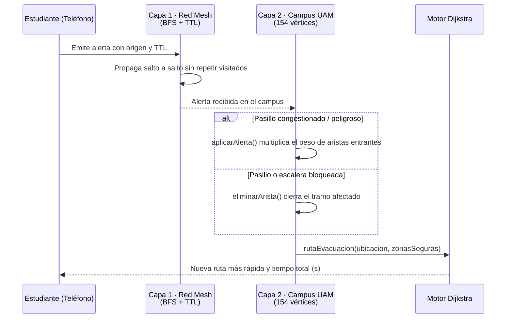

<div align="center">
  

  <h1>Unexuam</h1>

  <em>Evacuación Off-Grid para el campus UAM con grafos dirigidos y ponderados</em>

  <br /><br />

  [](https://www.python.org)
  [](https://flask.palletsprojects.com)
  [](mobile/)
  
  
  
  
</div>

<br />

<div align="center">
  <sub>Guiando a la comunidad universitaria hacia zonas seguras cuando colapsan internet y la red celular — sin librerías externas de grafos.</sub>
</div>

<br />

<div align="center">


**[Descripción general](#descripción-general)** · **[Las dos capas](#las-dos-capas-de-grafos)** · **[Funcionalidades](#funcionalidades-y-pantallas)** · **[Tecnologías y diseño](#tecnologías-y-diseño)** · **[Arquitectura](#arquitectura-y-estructura)** · **[Instalación](#instalación-y-ejecución)** · **[Comandos](#comandos-útiles)** · **[Pruebas](#pruebas-y-validación)**

</div>

<br />


## Descripción general

**Unexuam** es un prototipo de sistema de emergencia y evacuación **Off-Grid** para el campus real de la **Universidad Americana (UAM)**, desarrollado como proyecto final de **Programación Estructurada** (noviembre 2026) por **Br. James Santiago Fernandez Obregon**.

Está diseñado para operar cuando se caen internet y la red celular, ejecutándose en una red Wi-Fi local (LAN) y accesible desde cualquier teléfono conectado al mismo servidor sin dependencias externas en el navegador.

- **Grafos hechos a mano** — implementación pura en Python con las clases `Vertex` (`nombre`, `neig`) y `Graph` (`vertexs`), sin NetworkX ni `heapq`.
- **Comunicación tolerante a retardos** — red Mesh simulada donde una alerta salta de teléfono en teléfono mediante **BFS limitado por TTL**.
- **Evacuación dinámica sobre el campus real** — 154 vértices y 442 aristas dirigidas construidas a partir del plano real de OpenStreetMap de la UAM, con recálculo inmediato mediante **Dijkstra** ante bloqueos o congestión.

> [!NOTE]
> Este proyecto es un prototipo funcional: la red Mesh se **simula** sobre el grafo de teléfonos en memoria. La comunicación física directa por Bluetooth Low Energy o Wi-Fi Direct, así como la cola DTN persistente y flujo máximo, quedan planteadas como trabajo futuro.

<br />


## Las dos capas de grafos

Unexuam acopla dos grafos dirigidos y ponderados que reaccionan en cadena durante una emergencia:

| Capa | Vértices | Aristas (peso) | Algoritmo | Módulo |
|---|---|---|---|---|
| -CC0000?style=flat-square) | Teléfonos de los estudiantes | Enlace entre dispositivos (retardo en s) | **BFS limitado por TTL** (`propagarAlerta`) | `backend/mesh.py` |
| -0080FF?style=flat-square) | **154 vértices**: aulas por piso de edificios B, C y P, pabellones este/oeste, escaleras (incluyendo unión central B–C), pasarela del B, salidas, edificios y **12 zonas/puntos seguros** | Paso a pie entre lugares (tiempo en s; **442 aristas**) | **Dijkstra** (`dijkstra`, `rutaMasCorta`, `rutaEvacuacion`) | `backend/evacuacion.py` |

### Flujo ante una emergencia



<br />


## Funcionalidades y pantallas

La aplicación web móvil sincroniza el estado en tiempo real entre todos los teléfonos conectados a la misma LAN:

| Pestaña / Modo | Qué hace |
|---|---|
|  | Resumen del estado de las dos redes, ruta activa, **simulacros rápidos en 1 toque** (sismo, congestión, bloqueo B–C y alerta Mesh), botón de instalación PWA y actividad en vivo. |
|  | Visualización de teléfonos y enlaces dirigidos con su peso. Permite emitir alertas configurando el **TTL** con animación salto a salto en todos los dispositivos conectados. |
|  | **Buscador instantáneo de aulas** y accesos rápidos (`P-309`, `C-305`, `B-205`, `B-101`), guía paso a paso con **lectura por voz (TTS)** y navegación `← Anterior` / `Siguiente →`, vista 3D explotada por pisos (con escalera central B–C) y **mapa 3D interactivo** (arrastrar, pinch-to-zoom, doble toque, brújula `N ↑`, botones `+`/`−`/`◎`). |
|  | Inserción, actualización y eliminación de vértices y aristas en ambos grafos, más inspección de la lista de adyacencia. |
|  | Interfaz de consola clásica del curso (`python -m backend.menu`) para probar operaciones de grafos sin levantar el servidor web. |

<br />


## Tecnologías y diseño

| Categoría | Tecnología | Detalle |
|---|---|---|
|  | **Python 3.10+** | Lógica completa de grafos, BFS y Dijkstra implementada desde cero sin librerías externas. |
|  | **Flask** | Estado compartido en memoria protegido con `threading.Lock` y API REST JSON para los clientes en la LAN. |
|  | **HTML5 · CSS3 · JS vanilla** | Interfaz móvil con animación de entrada Off-Grid, sin frameworks ni CDNs: funciona completamente sin internet. |
|  | **Capacitor + motor offline** | Empaqueta el frontend y el grafo exportado desde `backend/datos.py` en un APK autónomo (`ni.edu.uam.unexuam`) con persistencia en `localStorage`. |
|  | **OpenStreetMap + SVG 3D** | Geometría real del campus (`frontend/static/campus-plano.json` y `frontend/static/img/mapa-campus-3d.svg`). |
|  | **unittest** | Suite de 31 pruebas (23 de backend + 8 de API, PWA y paridad frontend/backend). |

### Sistema de diseño

La interfaz sigue una estética móvil de alta legibilidad para situaciones de emergencia, con píldoras de `30 px`, tipografía **Nexa** (con fallback a sans-serif del sistema para operar 100% offline) y cuatro colores de alto contraste:


 `azul #0080FF` &nbsp;&nbsp;  `rojo #E23000` &nbsp;&nbsp;  `amarillo #FCD222` &nbsp;&nbsp;  `verde #00D656`

<br />


## Arquitectura y estructura

### Estructura del repositorio

```text
unexuam/
├── app.py                     # Servidor Flask: estado en memoria y API JSON
├── backend/                   # Lógica pura de grafos (sin dependencias externas)
│   ├── grafo.py               # Clases Vertex (nombre, neig) y Graph (vertexs)
│   ├── datos.py               # Campus real UAM (154 vértices, 442 aristas) y red Mesh
│   ├── evacuacion.py          # dijkstra, rutaMasCorta, rutaEvacuacion, aplicarAlerta
│   ├── mesh.py                # propagarAlerta (BFS limitado por TTL)
│   └── menu.py                # Menú interactivo de consola
├── frontend/                  # Interfaz web móvil 100% offline
│   ├── templates/index.html   # Shell de la aplicación
│   └── static/                # app.css, app.js, campus-plano.json, manifest.json e img/
├── tests/
│   ├── test_backend.py        # 23 pruebas unitarias de grafos, BFS y Dijkstra
│   └── test_api.py            # 7 pruebas de API Flask, 5 flujos de usuario y paridad de mapa
├── mobile/                    # App Android autónoma (Capacitor + motor offline; genera Unexuam.apk)
└── docs/
    ├── propuesta/             # Propuesta formal del proyecto (.docx y .md)
    ├── pitch/                 # Diapositivas (deck.html), guion, demo, preguntas y capturas
    └── mapa-campus/           # Scripts de extracción OSM y generación del mapa 3D/grafo
```

### API JSON (`app.py`)

| Método y ruta | Acción |
|---|---|
| `GET /api/estado` | Devuelve ambos grafos serializados, zonas seguras, ubicación, ruta, bloqueos, congestión e historial. |
| `POST /api/reiniciar` | Restaura la red Mesh, el campus o ambos a su estado inicial. |
| `POST /api/mesh/alerta` | Ejecuta `propagarAlerta(red, origen, ttl)` y registra los teléfonos alcanzados por salto. |
| `POST /api/campus/ruta` | Calcula `rutaEvacuacion` para un teléfono individual sin alterar el estado compartido. |
| `POST /api/campus/ubicacion` | Fija la ubicación compartida y calcula la ruta de evacuación más rápida. |
| `POST /api/campus/bloquear` / `desbloquear` | Elimina (`eliminarArista`) o restaura (`insertarArista`) pasillos o escaleras. |
| `POST /api/campus/congestionar` | Aplica `aplicarAlerta(campus, lugar, factor)` multiplicando el peso de las aristas entrantes. |
| `POST /api/<grafo>/vertice` · `arista` | Alta, baja y actualización de vértices y aristas en `mesh` o `campus`. |

<br />


## Instalación y ejecución

### Requisitos previos

- **Python 3.10** o superior
- **Flask** (`pip install flask`)

### 1. Clonar e instalar

```powershell
git clone https://github.com/jamesjsfouam/unexuam.git
cd unexuam
pip install flask
```

### 2. Ejecutar el servidor

```powershell
python app.py
```

La consola imprimirá las dos direcciones de acceso:

```text
 En este PC:        http://127.0.0.1:5000
 Desde el teléfono: http://192.168.x.x:5000  (misma Wi-Fi)
```

### 3. Conectar teléfonos en la misma red

1. Conecta los teléfonos a la **misma Wi-Fi** que el PC (o crea un punto de acceso desde el teléfono y conecta el PC a él).
2. Abre en el navegador del teléfono la dirección **«Desde el teléfono»**.
3. Si no carga, permite Python en el **Firewall de Windows** para redes privadas.
4. Opcional: usa **«Agregar a la pantalla de inicio»** para abrirla como aplicación móvil (`manifest.json`).

> [!TIP]
> Varios teléfonos pueden abrir Unexuam simultáneamente: todos comparten el estado de la red y del campus, y una alerta emitida desde uno se anima en tiempo real en los demás.

### 4. Compilar la app móvil Android (APK autónomo)

La carpeta [`mobile/`](mobile/) empaqueta la aplicación completa para que funcione en Android **sin necesidad de tener la PC encendida**:

```powershell
cd mobile
npm install            # solo la primera vez
npm run sync           # exporta backend/datos.py + frontend/ al proyecto Android
cd android
.\gradlew.bat assembleDebug
```

El APK queda en `mobile/android/app/build/outputs/apk/debug/app-debug.apk`.

<br />


## Comandos útiles

| Comando | Descripción |
|---|---|
| `python app.py` | Levanta el servidor web móvil en el puerto `5000` (`0.0.0.0`) |
| `python -m backend.menu` | Abre el menú interactivo de consola para operar los grafos |
| `python -m unittest discover -s tests -v` | Ejecuta las 30 pruebas (backend, API y paridad del mapa) |
| `cd mobile && npm run sync` | Sincroniza el grafo de `backend/datos.py` y el frontend con Android |

<br />


## Pruebas y validación

La suite en [`tests/`](tests/) incluye **30 pruebas automatizadas** (`test_backend.py` + `test_api.py`):

```powershell
python -m unittest discover -s tests -v
```

Cubren las operaciones fundamentales de `Graph` (inserción, búsqueda, eliminación de vértices/aristas y actualización de pesos), la propagación BFS con límite de `TTL` y prevención de ciclos en `propagarAlerta`, el cálculo de rutas mínimas con `dijkstra` / `rutaEvacuacion`, y la reevaluación de rutas tras `aplicarAlerta` y bloqueos de escaleras o pasillos del campus UAM.

<br />

---

<div align="center">
  

  <br />

  <sub><strong>Unexuam · Evacuación Off-Grid · Campus UAM</strong></sub>
  <br />
  <sub>Plano del campus basado en datos de © colaboradores de <a href="https://www.openstreetmap.org/copyright">OpenStreetMap</a> (licencia ODbL).</sub>
</div>
